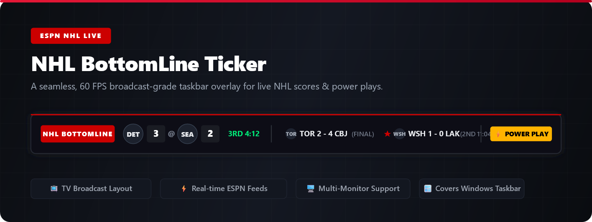

NHL BottomLine Taskbar Ticker



[](https://github.com/pcjake22/nhl-bottomline-ticker/releases/latest)
[](https://github.com/pcjake22/nhl-bottomline-ticker)
[](https://www.python.org/)
[](https://pypi.org/project/PyQt6/)

A lightweight broadcast-style bottom ticker that docks directly over your physical taskbar on any monitor. Built primarily for hockey with real-time ESPN scoreboard feeds, period clocks, power-play alerts, and an unbroken 60 FPS around-the-league crawl with official team logos—plus built-in support to switch over to NFL, NBA, and MLB action anytime.

---

## ⚡ Quick Start (No Python Required)

1. Download **[`ticker.exe`](https://github.com/pcjake22/nhl-bottomline-ticker/releases/latest/download/ticker.exe)** from the Releases tab.
2. Double-click `ticker.exe` to run.
3. Left-click the brand badge to jump between sports, or right-click anywhere for monitor settings and options.

---

## 🎮 Controls

* **Left-Click Brand Badge:** Instantly toggle between **NHL** (Red), **NFL** (Blue), **NBA** (Orange), and **MLB** (Green).
* **Right-Click Anywhere:**
  * **Switch Sport:** Choose any league directly from the menu.
  * **Move to Screen:** Transfer the ticker ribbon across multi-monitor setups.
  * **Force Score Refresh:** Manually fetch the latest data immediately.
  * **Minimize / Exit:** Hide or quit the application.

---

## ✨ Features

* **Authentic NHL Broadcast Experience:** Full coverage for hockey scores, power plays, and continuous crawls with official NHL team branding and dynamic team colors.
* **Multi-Sport Flexibility:** Easily flip from hockey night to Sunday football, hoops, or baseball with live scoreboards for NFL, NBA, and MLB.
* **Dynamic Sport Themes:** Instant visual feedback when changing leagues with dedicated theme accents (NHL Crimson, NFL Blue, NBA Orange, MLB Green).
* **Continuous 60 FPS Crawl:** Hardware-accelerated ticker loop with official team logos and smooth scrolling.
* **Parallel Asset Fetching:** Multithreaded background loading ensures instant sport switching with zero UI freezing.
* **Multi-Monitor Awareness:** Docks seamlessly to the bottom edge of any chosen display.

---

## 💻 Manual Installation (Run from Source)

```bash
# 1. Clone repository
git clone [https://github.com/pcjake22/nhl-bottomline-ticker.git](https://github.com/pcjake22/nhl-bottomline-ticker.git)
cd nhl-bottomline-ticker

# 2. Install dependencies
pip install -r requirements.txt

# 3. Launch application
python ticker.py